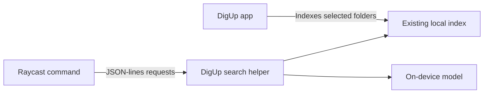

<p align="center"></p>

# DigUp Local Search for Raycast

[](https://github.com/o1o1o3/raycast-digup/actions/workflows/ci.yml)
[](https://github.com/o1o1o3/raycast-digup/releases/latest)
[](LICENSE)

Search your local code, documents and screenshots from Raycast with [DigUp](https://github.com/ARahim3/DigUp). Describe what you remember, or search by exact words. DigUp owns the index and on-device model; this extension brings its search results into Raycast.

Independent community integration. Not affiliated with DigUp or Raycast and not published in the Raycast Store.

## Commands

| Command                | What it does                                                           |
| ---------------------- | ---------------------------------------------------------------------- |
| **Search Code**        | Finds source code by meaning, symbol or words, with matching excerpts. |
| **Search Files**       | Searches indexed documents and media, with a file-type filter.         |
| **Search Screenshots** | Finds screenshots by content or visible text.                          |
| **Open DigUp**         | Opens DigUp to manage folders, models and indexing.                    |

Results support opening files, revealing them in Finder, copying paths or excerpts, and Quick Look. Choose VS Code, Cursor or Zed in Extension Preferences to open code at the matching line.

## Requirements

- macOS and Raycast; tested with Raycast **2.7.3**.
- DigUp **0.6.1**, with folders configured and indexing started. Other versions have not been verified against its search-service protocol.
- DigUp's downloaded model for semantic search. Keyword-only fallback is shown when the model is unavailable.

The extension uses DigUp's existing settings and index. It does not automatically select your home directory or download models.

## Install

1. Install [DigUp](https://github.com/ARahim3/DigUp), for example with Homebrew:

   ```sh
   brew tap arahim3/tap
   brew install --cask arahim3/tap/digup
   ```

2. Open DigUp, download its model, and choose folders. Configure code folders separately in DigUp's Code settings. Allow indexing to start.
3. Download `digup-local.rayext` from the [latest release](https://github.com/o1o1o3/raycast-digup/releases/latest) and open it to import the extension into Raycast.
4. Search for **Search Code**, **Search Files** or **Search Screenshots** in Raycast. Look for the **DigUp** subtitle.

A `SHA256SUMS` file accompanies each release. To verify a download, place both files in the same folder and run `shasum -a 256 -c SHA256SUMS` there.

Alternatively, import from source using the development instructions below. GitHub releases are distributed independently of the Raycast Store.

## Usage

Try a code query such as `retry a failed request`, a function name, or a description of a document. Results grow as DigUp indexes your selected folders; initial indexing can take time.

| Shortcut       | Action                              |
| -------------- | ----------------------------------- |
| Return         | Open selected result                |
| Command-Return | Reveal in Finder                    |
| Command-C      | Copy file path                      |
| Space          | Quick Look                          |
| Command-K      | More actions, preferences and retry |

Extension Preferences let you select the DigUp application and code editor. The default editor opens the system-associated application. After changing DigUp folders or exclusions, choose **Retry / Reload Settings**.

PDF page numbers and media timestamps are displayed, but opening at those positions is not implemented. Screenshot classification and searchable file formats are determined by DigUp.

## Privacy and architecture



The extension sends queries to the installed local helper through stdin/stdout. It contains no analytics or cloud search calls. Model downloads and DigUp updates are managed by DigUp itself. macOS permissions and DigUp's exclusions still apply. Search results are also filtered against configured folder boundaries by the extension.

Each mounted command owns a helper process. Closing the command closes pending requests and its helper process group, including the encoder. Search input is debounced; obsolete results are discarded. Excerpts are rendered as text, preventing document Markdown from loading remote images.

See [architecture](docs/architecture.md) and the [security policy](SECURITY.md) for boundaries and limitations.

## Development

Use Node **22.22.2 or newer**; `.nvmrc` pins the version used by CI.

```sh
git clone https://github.com/o1o1o3/raycast-digup.git
cd raycast-digup
nvm use
npm ci
npm run dev
```

`npm run dev` imports the extension and starts Raycast's development watcher. Stop it with Control-C when finished. Do not run UI automation while someone is typing on the same Mac.

```sh
npm run check   # build, types, tests, lint and formatting
npm run bundle  # create digup-local.rayext
```

Build before running `typecheck` on a fresh checkout: Raycast generates `raycast-env.d.ts`. Automated tests use a fixture process and need neither DigUp nor your files. Live search validation requires the app and a local index.

## Troubleshooting

- **Keywords Only:** check DigUp's model download. The engine's warning is shown when available.
- **No Matches Yet:** try an exact filename or symbol, confirm the configured folders, and allow indexing time.
- **DigUp Needs Attention:** check the application path, open DigUp, then retry.
- **Missing files:** supported formats, exclusions, access permissions and indexing progress can all affect results.

## Contributing and support

Read [CONTRIBUTING.md](CONTRIBUTING.md) before opening a pull request. Report reproducible bugs through [Issues](https://github.com/o1o1o3/raycast-digup/issues); share only sanitized examples. Report vulnerabilities privately as described in [SECURITY.md](SECURITY.md).

## License and acknowledgments

[MIT](LICENSE). The icon is derived from DigUp by Abdur Rahim and retains its MIT attribution in [THIRD_PARTY_NOTICES.md](THIRD_PARTY_NOTICES.md). DigUp and its models are separate dependencies and are not bundled with this extension.
